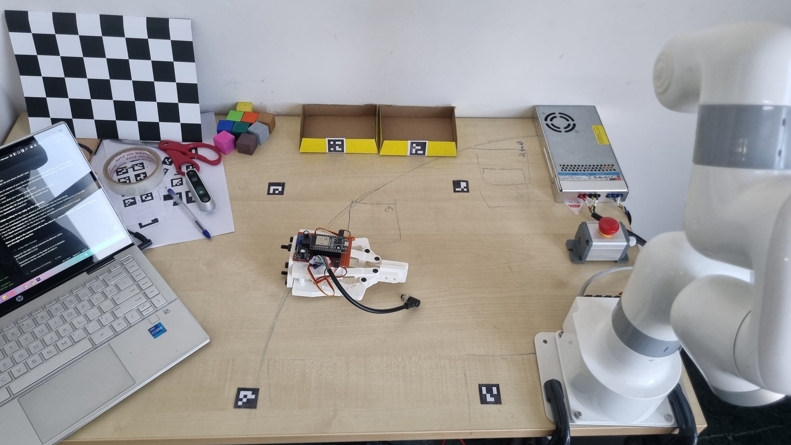
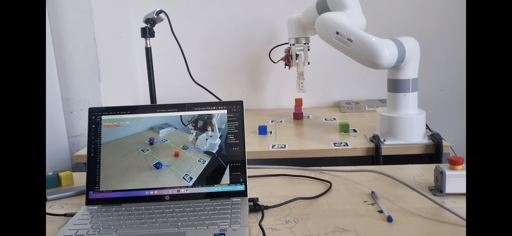

# 🤖 Autonomous Object Perception & Manipulation (RPM)

> **Real-time robotic pick-and-place sorting system** using computer vision, depth perception, and xArm robotic arm control.

---

## 📁 Project Resources

| Resource | Link |
|----------|------|
| 🎬 Video Demo, PPT & Report | [Google Drive](https://drive.google.com/file/d/1_gH-eMLU9dsza4KSZNG2K8226SaciRYQ/view?usp=drive_link) |
| 📄 Local Report | [RPM_Report.pdf](./RPM_Report.pdf.pdf) |

---

## 📸 Project Media

<table>
  <tr>
    <td align="center">
      
      <br><b>Robot Setup</b>
    </td>
    <td align="center">
      
      <br><b>System in Action</b>
    </td>
  </tr>
</table>

> 🎥 **Full video demonstration and presentation slides** available on [Google Drive](https://drive.google.com/file/d/1_gH-eMLU9dsza4KSZNG2K8226SaciRYQ/view?usp=drive_link)

---

## 🌟 Overview

An advanced, real-time robotic pick-and-place sorting system utilizing:
- **YOLOv8** for real-time object detection
- **ArUco / AprilTag** marker tracking for workspace calibration
- **Intel RealSense** depth perception
- **Asynchronous voice synthesis** for natural interaction
- **xArm robotic arm** control via Python SDK

The pipeline enables dynamic, state-driven sorting of objects with an interactive Topographic Depth HUD and voice announcements.

---

## ✨ Features

- 🔍 **Real-Time Object Detection** — Threaded YOLOv8 worker detects colored blocks without bottlenecking the camera feed
- 📍 **Dynamic Workspace & Bin Tracking** — AprilTag (36h11) ArUco markers define quadrilateral workspace and target bin locations with calibration fallback
- 🗺️ **Topographic Depth HUD** — Live color-mapped topographic view of workspace with real-time Z-depth calculations
- 🔊 **Asynchronous Voice Announcer** — Threaded TTS (`pyttsx3`) narrates actions without freezing robot motion
- 🏗️ **Intelligent Pick & Place** — Dynamic drop-height calculation with memory offsets to safely stack blocks
- 🎮 **Interactive State Machine** — Switch between Auto-Sort, Custom Pick & Place, and LLM Chat mode via keyboard UI
- 🛡️ **Automated Error Recovery** — Built-in fault detection that safely resets the arm and clears errors

---

## 🛠️ Hardware Requirements

| Component | Details |
|-----------|---------|
| **Robotic Arm** | UFACTORY xArm (via `xarm-python-sdk`) |
| **Gripper** | Custom HTTP-controlled gripper (or standard xArm gripper fallback) |
| **Camera** | Intel RealSense Depth Camera (D415/D435 recommended) |
| **Fiducial Markers** | AprilTag 36h11 — IDs 16–19 for workspace corners; IDs 20, 24, 25, 27 for bins |

---

## 📦 Software Dependencies

Requires **Python 3.8+**. Install dependencies:

```bash
pip install opencv-python opencv-contrib-python numpy pyyaml requests pyttsx3 ultralytics
```

---

## 📂 Repository Structure

```
RPM/
├── media/                          # Images and screenshots
│   ├── 20260504_170723.jpg
│   └── Screenshot_20260508_095453_Gallery.jpg
├── Arm_to_object/
│   ├── object_pick.py              # Core pick-and-place logic
│   └── tag_robot_mapping.yaml      # AprilTag-to-robot coordinate map
├── Camera_Caliberation/
│   ├── Camera_caliberation.py      # Camera calibration script
│   └── camera_calibration.yaml    # Calibration output
├── Lite6_arm_pos/
│   ├── Pos_on_april_tags.py        # Position estimation from AprilTags
│   └── lite6_end_effector.yaml    # End-effector configuration
├── automated_pipeline_v3.py        # Pipeline v3
├── automated_pipeline_v4.py        # Pipeline v4
├── automated_pipeline_v5.py        # Pipeline v5 (latest stable)
├── automated_pipeline_vlm.py       # Vision-Language Model pipeline
├── run_pipeline.py                 # Main pipeline runner
├── visualize_and_pick.py           # Visualization + pick module
├── visualize_and_pick_v2.py        # Visualization + pick module v2
├── workspace.py                    # Workspace management
├── workspace_calibration.yaml      # Workspace calibration config
├── realsense_view.py               # RealSense camera viewer
├── tune_hsv.py                     # HSV color tuning utility
├── vlm_answering.py                # VLM question-answering module
├── test_connect.py                 # Arm connectivity test
├── project_guidelines.txt          # Development guidelines
└── RPM_Report.pdf.pdf              # Project report
```

---

## 🚀 Quick Start

### 1. Connect Hardware
- Connect Intel RealSense camera via USB 3.0
- Connect xArm via Ethernet and note the IP address

### 2. Configure
Update the arm IP and settings in `workspace_calibration.yaml`:
```yaml
arm_ip: "192.168.1.XXX"
```

### 3. Run the Pipeline
```bash
# Test connectivity
python test_connect.py

# Run main pipeline
python run_pipeline.py

# Or run the latest automated pipeline
python automated_pipeline_v5.py
```

### 4. Controls (during runtime)
| Key | Action |
|-----|--------|
| `1` | Auto-Sort mode |
| `2` | Custom Pick & Place mode |
| `3` | LLM Chat mode |
| `q` | Quit |

---

## 🔧 Configuration Files

| File | Purpose |
|------|---------|
| `workspace_calibration.yaml` | Workspace bounds and arm IP |
| `Camera_Caliberation/camera_calibration.yaml` | Camera intrinsics |
| `Lite6_arm_pos/lite6_end_effector.yaml` | End-effector offsets |
| `Arm_to_object/tag_robot_mapping.yaml` | AprilTag ID to robot coordinate mapping |

---

## 📊 Pipeline Versions

| Version | Description |
|---------|-------------|
| `automated_pipeline_v3.py` | Initial multi-threaded version |
| `automated_pipeline_v4.py` | Enhanced with voice announcer |
| `automated_pipeline_v5.py` | Latest stable — full state machine with topographic HUD |
| `automated_pipeline_vlm.py` | Experimental VLM-driven sorting |

---

## 📎 Resources & Links

- 🎬 **[Video Demo + PPT + Report (Google Drive)](https://drive.google.com/file/d/1_gH-eMLU9dsza4KSZNG2K8226SaciRYQ/view?usp=drive_link)**
- 🤖 [UFACTORY xArm Python SDK](https://github.com/xArm-Developer/xArm-Python-SDK)
- 📷 [Intel RealSense SDK](https://github.com/IntelRealSense/librealsense)
- 🧠 [Ultralytics YOLOv8](https://github.com/ultralytics/ultralytics)

---

## 👥 Contributors

- **Vinay Verma** — [vermavinay982](https://github.com/vermavinay982)
- **Abhinay** — [iabhinay5](https://github.com/iabhinay5)

---

## 📜 License

This project is for academic and research purposes.
